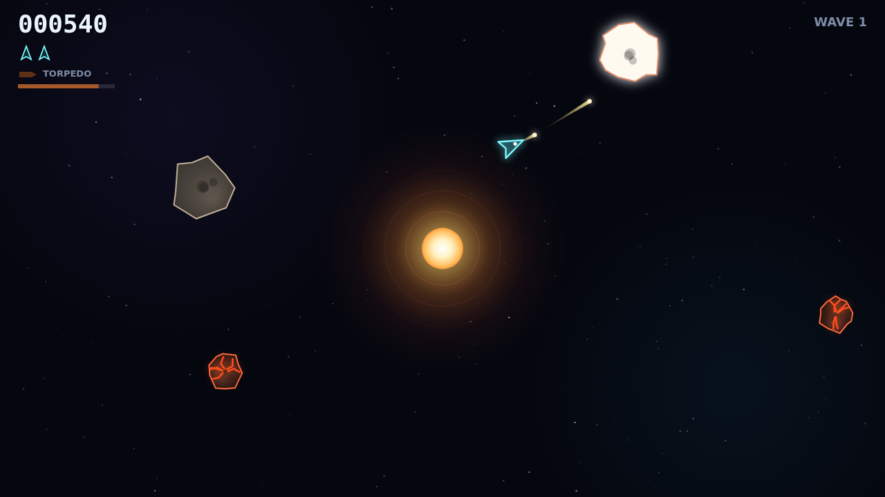

# Shatter

Shatter is a fast, tense rock shooter fought on a single wrapping field with a
star burning at its centre. You fly a small ship on pure momentum, turning and
thrusting while jagged rocks tumble around you, and every rock you break comes
apart into smaller, faster pieces until the last fragment winks out.

A wave starts with a handful of big armored rocks. They shrug off a few hits
first, cracking and glowing hotter each time, before they split into two
mediums, and those into smalls. Clear the field and the next wave rolls in,
denser and quicker, while a saucer drops in every so often to hunt you down.

The star is the whole board's engine. It never touches your ship, but it pulls
on every bullet and every rock, so your shots bend as they pass it. Learn the
curve and you can whip a bullet around the star to hit a rock hiding on the far
side. Rocks swing past on looping paths, and anything the star swallows comes
right back in from the edge of the field, so the well keeps the fight churning.

When a rock won't break in time, you have the torpedo: one guided warhead on a
ten-second recharge. It locks onto whatever sits in a narrow cone ahead, flies
dead straight through the gravity that bends everything else, and smashes any
rock in a single hit. Pick the right moment and you get a clean kill. Waste it
and you'll be waiting for the recharge.
